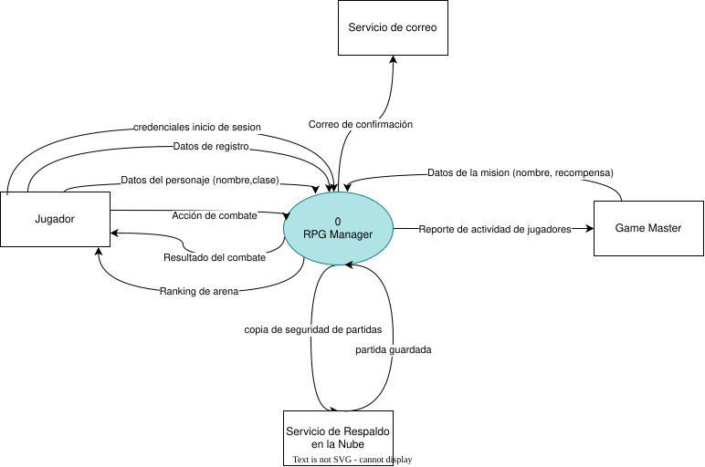
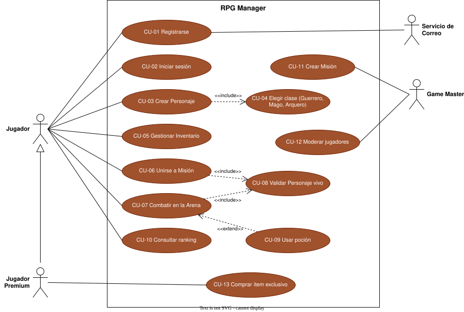
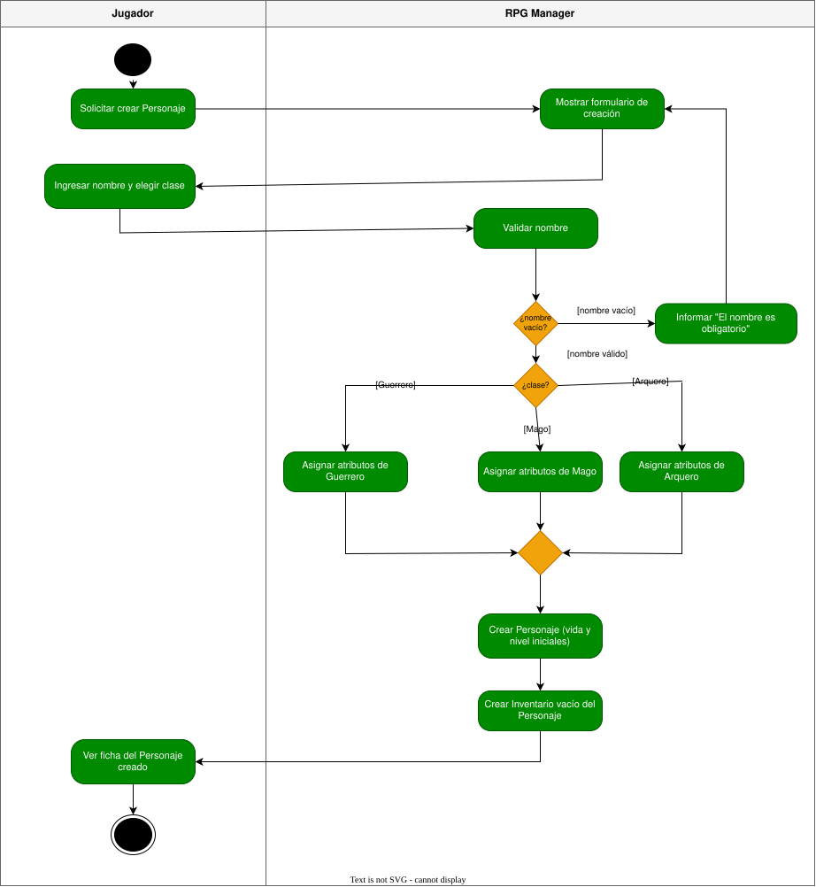

# Taller Práctico: Modelado de Sistemas con draw.io · RPG Manager

**Asignatura:** Análisis de Sistemas  
**Estudiante:** Andrés Leonardo Fonseca  
**Usuario de GitHub:** [CarlosRoldon](https://github.com/CarlosRoldon)  
**Proyecto:** RPG Manager  
**Fecha:** Noviembre de 2026  

---

## Estructura del Directorio

El repositorio contiene tanto las fuentes editables generadas en draw.io (`.drawio`) como las exportaciones vectoriales (`.svg`) configuradas con la opción de retención de esquema para permitir su posterior edición y renderizado nítido en GitHub:

```text
├── diagramas-drawio/
│   ├── 01_contexto_rpg.drawio
│   ├── 01_contexto_rpg.svg
│   ├── 02_casos_uso_rpg.drawio
│   ├── 02_casos_uso_rpg.svg
│   ├── 03_actividades_combate.drawio   # Contiene dos páginas: CU-07 y CU-03
│   ├── 03_actividades_cu07.svg
│   └── 03_actividades_cu03.svg
└── README.md
```

---

## Bloque 1 · Diagrama de Contexto (DFD Nivel 0)

El diagrama de contexto conceptualiza el sistema completo como un único proceso central delimitado por una frontera estricta, comunicándose exclusivamente con el exterior a través de paquetes de información.



### Ejercicio 1A · Identificación de flujos complementarios

| Identificador | Origen | Flujo de Datos (Sustantivo) | Destino | Justificación Técnica |
|---|---|---|---|---|
| **F10** | Jugador | Datos de autenticación (usuario, contraseña cifrada) | RPG Manager | Requerido para iniciar sesión y validar permisos de acceso. |
| **F11** | Servicio de Respaldo en la Nube | Paquete de datos de partida respaldada | RPG Manager | Requerido para la restauración y carga del estado persistente del jugador. |

### Análisis y Corrección de Errores (Bugs del Bloque 1)

1. **Inclusión indebida de almacenes de datos internos:**  
   *Diagnóstico:* En un DFD de nivel 0 no se pueden colocar elementos como "Base de datos de Personajes". El sistema debe tratarse como una caja negra uniforme; la persistencia y los almacenes de datos pertenecen al diseño interno y se modelan a partir del DFD de nivel 1.

2. **Nomenclatura incorrecta en flujos (Confusión de flujo con proceso):**  
   *Diagnóstico:* La etiqueta "Crear Personaje" describe una operación funcional (verbo + objeto), lo cual corresponde a un caso de uso o proceso. Un flujo de datos debe etiquetarse estrictamente como un sustantivo representativo del paquete de datos que viaja por el canal (por ejemplo: `datos de creación del personaje`).

3. **Comunicación directa entre entidades externas:**  
   *Diagnóstico:* La conexión punto a punto entre `Jugador` y `Game Master` viola la semántica del diagrama de contexto. Las entidades externas solo pueden comunicarse con el proceso central `0 RPG Manager`. Cualquier interacción externa que no pase por la lógica del software está fuera del alcance del modelado del sistema.

---

## Bloque 2 · Diagrama de Casos de Uso

Representa el alcance funcional y el comportamiento observable del sistema desde la perspectiva de los actores involucrados.



### Ejercicio 2A · Generalización y herencia de actores

- **Dirección de la generalización:**  
  La flecha con cabeza triangular cerrada vacía apunta desde el actor especializado (`Jugador Premium`) hacia el actor base o general (`Jugador`). En UML, la jerarquía se interpreta como una relación de tipo *"es un"*: el Jugador Premium *es un* Jugador con privilegios adicionales.

- **Heredabilidad de asociaciones:**  
  `Jugador Premium` no requiere conectores explícitos hacia los casos de uso básicos (`CU-01` al `CU-10`) porque hereda de forma automática todas las asociaciones, permisos y comportamientos del actor general `Jugador`. En el diagrama solo se grafica su asociación exclusiva con `CU-13 Comprar ítem exclusivo`.

### Análisis y Corrección de Errores (Bugs del Bloque 2)

1. **Definición de caso de uso sin acción:**  
   *Diagnóstico:* La burbuja llamada "Inventario" es un sustantivo que denota una entidad o pantalla, no una meta orientada a valor. Todo caso de uso debe redactarse como un verbo en infinitivo seguido del objeto receptor (por ejemplo: `Gestionar Inventario`).

2. **Ubicación errónea de actores dentro del límite del sistema:**  
   *Diagnóstico:* El actor `Game Master` estaba dibujado dentro del rectángulo del sistema. Los actores son agentes externos que interactúan con las fronteras del software, por lo que siempre deben posicionarse fuera del límite del sistema (*system boundary*).

3. **Sentido invertido en la relación de inclusión (`<<include>>`):**  
   *Diagnóstico:* La relación de dependencia apuntaba de `CU-04 Elegir clase` a `CU-03 Crear Personaje`. La dirección correcta parte obligatoriamente del caso de uso base hacia el caso de uso incluido (`CU-03` $\rightarrow$ `CU-04`), indicando que el primero contiene al segundo.

4. **Asociación directa ilegal entre actores:**  
   *Diagnóstico:* Se trazó una línea sólida de asociación comunicando directamente al `Jugador` con el `Game Master`. En UML, los actores no se asocian directamente entre sí; las asociaciones solo conectan actores con casos de uso (entre actores únicamente son válidas relaciones de generalización o herencia).

---

## Bloque 3 · Diagramas de Actividades

Los diagramas de actividades modelan el comportamiento interno, el orden procedimental, las condiciones de bifurcación y las responsabilidades concurrentes del sistema.

### CU-07 Combatir en la Arena (Integrando Ejercicio 3A)

Detalle del flujo secuencial y transaccional entre el usuario y el motor de combate.



#### Ejercicio 3A · Flujo alternativo por ausencia de pociones

- **Carril responsable de la decisión:**  
  La decisión pertenece al carril **RPG Manager**, dado que el sistema es quien tiene acceso al estado del inventario y tiene la autoridad lógica para validar existencias.

- **Guarda afirmativa `[tiene pociones]`:**  
  Dirige el flujo hacia la acción `Restaurar vida del Personaje`, continuando hacia el nodo de unión (*merge*) para ceder el turno al oponente.

- **Guarda negativa `[sin pociones]`:**  
  Dirige la transición a la acción `Informar "Pociones agotadas"` y retorna el control a la decisión del Jugador `¿Acción a realizar?`, permitiéndole elegir un camino alternativo (como atacar) sin perder el turno de forma inconsistente.

### CU-03 Crear Personaje (Página 2 · Ejercicio 3B)

Modelado completo del flujo de registro y parametrización de un nuevo héroe.


- **Caso de uso anidado o subyacente:**  
  Dentro de este flujo de actividades se materializa de forma explícita el caso de uso **CU-04 Elegir clase**. La bifurcación basada en las condiciones `[Guerrero]`, `[Mago]` y `[Arquero]` ejecuta el comportamiento incluido (`<<include>>`) que se había declarado a nivel conceptual en el Bloque 2.

### Análisis y Corrección de Errores (Bugs del Bloque 3)

1. **Decisión con ramas incompletas (Falta de exhaustividad):**  
   *Diagnóstico:* El rombo "¿Tiene flechas?" únicamente contemplaba la guarda `[sí]`. En un diagrama de actividades, las decisiones lógicas deben cerrar el conjunto de posibilidades con guardas mutuamente excluyentes; era obligatorio modelar la salida `[no]` y el camino de excepción correspondiente.

2. **Concurrencia sin sincronización (Fork sin Join):**  
   *Diagnóstico:* Se abrió una bifurcación paralela (*fork*) que terminaba en dos nodos finales separados. Esto provoca inconsistencias de concurrencia: alcanzar un nodo final de actividad detendría todo el flujo antes de que la otra rama complete su labor. Los flujos abiertos por una barra de sincronización concurrente deben converger en una barra de unión (*join*) antes de llegar al fin del proceso.

3. **Mala asignación de responsabilidades en carriles:**  
   *Diagnóstico:* La actividad `Calcular daño al oponente` figuraba en el carril del `Jugador`. El cálculo de atributos, defensas y fórmulas matemáticas es una regla de negocio que computa el sistema, por lo que su ubicación correcta es en el carril de **RPG Manager**.

---

## Bloque 4 · Versionamiento y Registro en GitHub

- **Estructura de confirmación:** Todo el trabajo se encuentra versionado respetando los lineamientos de trazabilidad exigidos.
- **Mensaje del commit:** `[semana-N] diagramas contexto, casos de uso y actividades`
- **Enlace a la confirmación (Commit URL):** https://github.com/CarlosRoldon/Taller_diagramas/commit/15ff068

---

## Bloque 5 · Reflexión Técnica y Conceptual

1. **¿Por qué el diagrama de contexto omite la base de datos si el RPG Manager depende de ella?**  
   Porque el diagrama de contexto concibe al sistema bajo el principio de *caja negra*. Su propósito exclusivo es definir las fronteras del software e ilustrar qué actores y sistemas externos interactúan con él. Los almacenes de datos internos residen dentro de la frontera del sistema; exponerlos en el nivel 0 violaría el principio de encapsulamiento arquitectónico.

2. **Diferencia conceptual entre el flujo "datos del personaje" y el caso de uso "Crear Personaje".**  
   "Datos del personaje" es una estructura pasiva de información (un sustantivo con atributos como nombre, clase y estadísticas) que viaja a través de un canal de comunicación. En contraste, "Crear Personaje" es un proceso funcional activo (un verbo más su objeto) que engloba validaciones de negocio, instanciación de clases y persistencia en memoria o disco.

3. **Ejemplos propios de relaciones `<<include>>` y `<<extend>>` en el RPG Manager:**  
   - **Relación `<<include>>`:**  
     *Caso base:* `Comprar ítem exclusivo` $\xrightarrow{\text{<<include>>}}$ `Validar saldo de monedas`.  
     *Justificación:* Cada vez que un jugador intenta adquirir un objeto, el sistema ejecuta obligatoriamente la verificación de fondos antes de debitar el monto y transferir el ítem.
   - **Relación `<<extend>>`:**  
     *Caso extensor:* `Activar habilidad especial de clase` $\xrightarrow{\text{<<extend>>}}$ `Ejecutar ataque en combate`.  
     *Justificación:* El ataque en combate puede desarrollarse de forma estándar; el uso de una habilidad especial es una rama opcional condicionada a que el jugador cuente con suficiente energía o maná y decida activarla.

4. **¿Qué valor analítico aporta el diagrama de actividades que no puede verse en el de casos de uso?**  
   El diagrama de casos de uso se limita a describir *qué* funcionalidades ofrece el software y *quiénes* las ejecutan, pero no revela el comportamiento interno. El diagrama de actividades aporta la dimensión temporal y lógica: el orden secuencial de pasos, condiciones lógicas (guardas), iteraciones y bucles (rondas de combate), tareas en paralelo (*fork/join*) y la distribución exacta de responsabilidades por componentes mediante carriles (*swimlanes*).

5. **En Programación Orientada a Objetos, ¿en qué clase debería residir el método "Calcular daño al oponente"?**  
   Debe ubicarse prioritariamente en la clase controladora del dominio de batalla, como `ArenaDeCombate` o `GestorDeCombate` (por ejemplo: `calcularDanio(atacante, defensor)`). Esta clase concentra el contexto completo del encuentro al cruzar las estadísticas ofensivas del atacante con la armadura del defensor y aplicar modificadores de entorno. Una alternativa orientada a polimorfismo es definir `calcularDanioGenerado()` dentro de `Personaje` (delegando en subclases como `Guerrero` o `Mago`) y recibir como parámetro la entidad objetivo.

6. **Criterio de selección: ¿Cuándo utilizar PlantUML y cuándo draw.io en proyectos reales?**  
   - **PlantUML:** Ideal para proyectos de desarrollo continuo donde la documentación debe residir junto al código fuente en repositorios Git. Al ser texto plano, permite trazabilidad línea por línea, revisiones en *Pull Requests* y automatización en pipelines de CI/CD.
   - **draw.io:** Preferible en fases iniciales de descubrimiento, diseño colaborativo y comunicación visual con clientes o *stakeholders* no técnicos. Brinda control total sobre el diseño estético, distribución espacial, paletas cromáticas y presentaciones ejecutivas.

---

## Autoevaluación de Habilidades

| Competencia Evaluada | No entendí | En desarrollo | ¡Dominado! |
|---|:---:|:---:|:---:|
| Dominio operativo de draw.io (lienzo, figuras, conectores y estilos) | ☐ | ☐ | **X** |
| Modelado de Diagrama de Contexto y flujos de datos (DFD Nivel 0) | ☐ | ☐ | **X** |
| Modelado de Actores, Límite del Sistema y Casos de Uso | ☐ | ☐ | **X** |
| Dominio de relaciones `<<include>>`, `<<extend>>` y generalización | ☐ | ☐ | **X** |
| Diagramas de actividades: carriles, bifurcaciones y guardas completas | ☐ | ☐ | **X** |
| Concurrencia y sincronización mediante Fork y Join | ☐ | ☐ | **X** |
| Exportación de diagramas a SVG editable y versionamiento formal en Git | ☐ | ☐ | **X** |